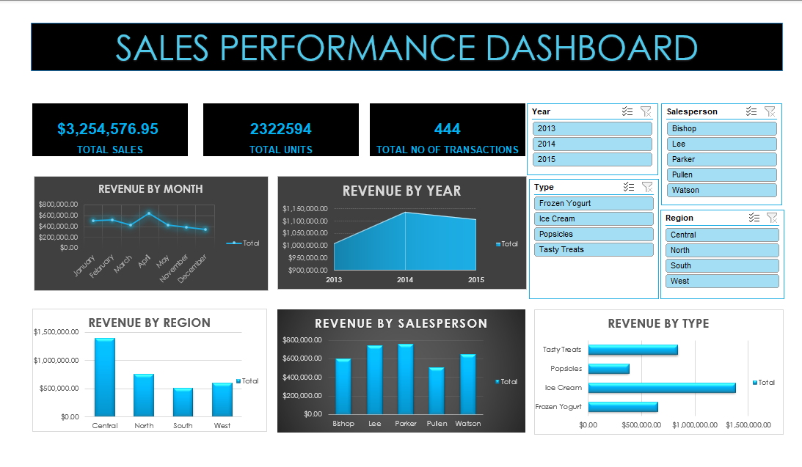
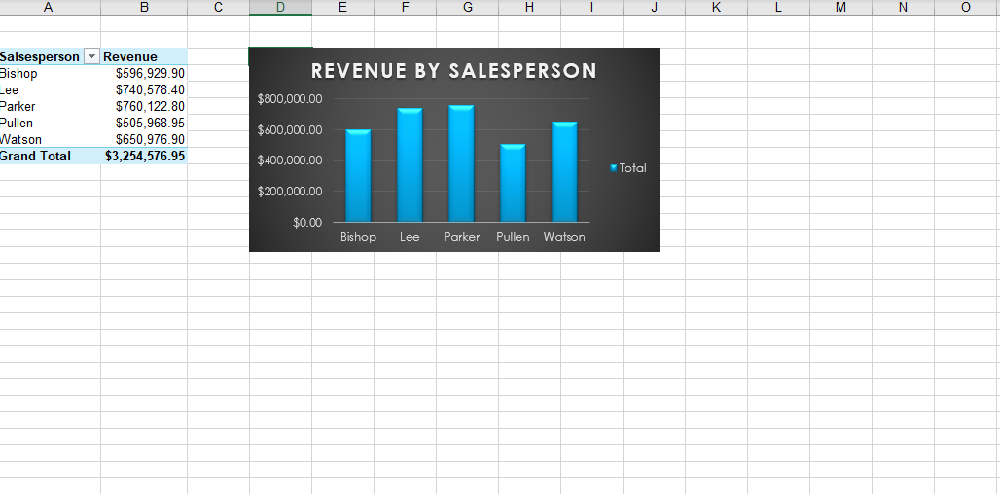
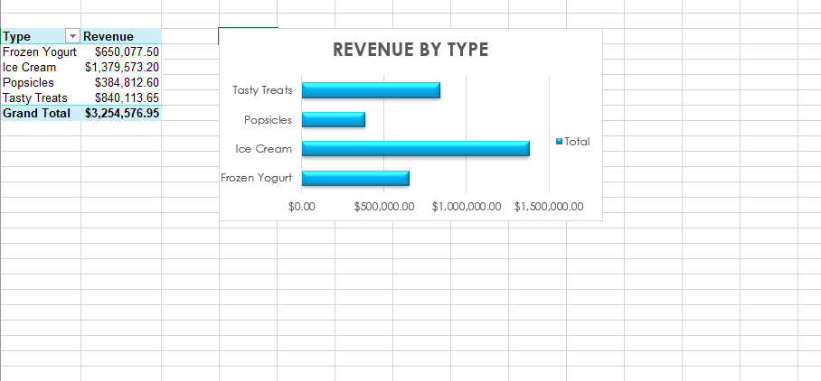
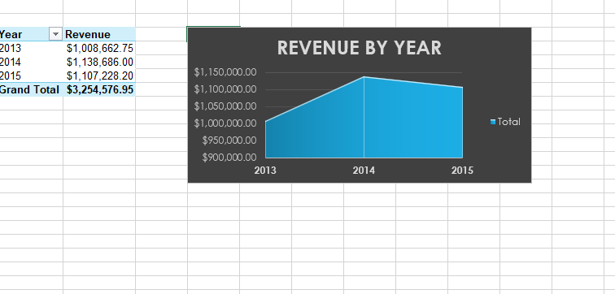
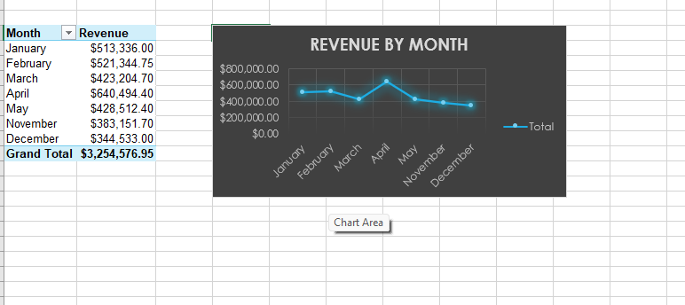
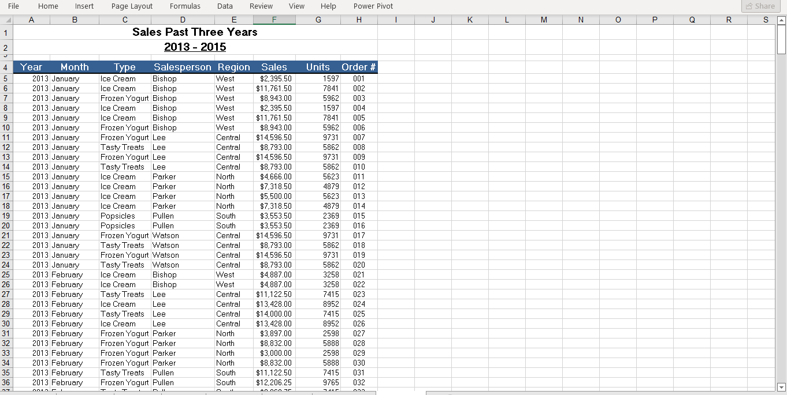
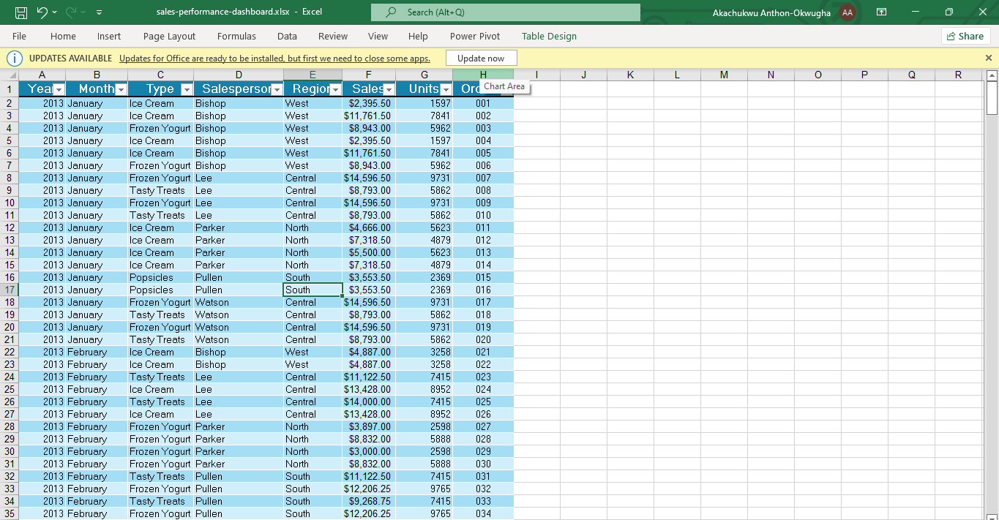
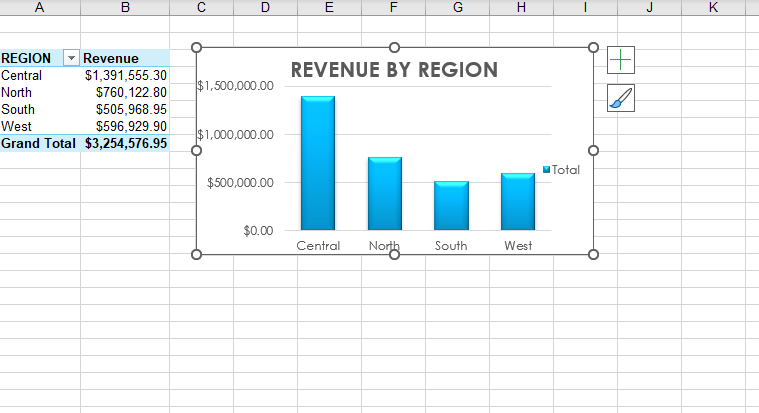

 
# 📊 Sales Performance Analysis

### Excel-Based Data Analytics & Dashboard Project



> A Microsoft Excel project that transforms historical sales transactions into useful business insights through data-quality checks, PivotTables, PivotCharts, and an interactive-style dashboard.

**Prepared by:** Akachukwu Anthony-Okwugha  
**Project period covered:** 2013–2015  
**Documentation date:** October 2026  
**Tools:** Microsoft Excel · Formulas · PivotTables · PivotCharts · Dashboard Development

---

## 📌 Table of Contents

 [🔎 Project Overview](#-project-overview)
- [🎯 Project Objectives](#-project-objectives)
- [❓ Business Questions](#-business-questions)
- [🗂️ Dataset Description](#️-dataset-description)
- [🧹 Data Cleaning and Preparation](#-data-cleaning-and-preparation)
- [⚙️ Analysis Methodology](#️-analysis-methodology)
- [📈 Analysis and Findings](#-analysis-and-findings)
- [📊 Dashboard](#-dashboard)
- [💡 Key Insights](#-key-insights)
- [✅ Recommendations](#-recommendations)
- [⚠️ Limitations](#️-limitations)
- [🧰 Tools and Skills](#-tools-and-skills)
- [🖼️ Project Screenshots](#️-project-screenshots)
- [🏁 Conclusion](#-conclusion)

---

## 🔎 Project Overview

This project analyzes historical sales data using Microsoft Excel to understand revenue performance across regions, salespeople, product types, years, and months.

The supplied dataset contains **444 sales transactions** from 2013 to 2015. Each record includes the year, month, product type, salesperson, region, sales value, units sold, and order number. After checking and preparing the data, PivotTables and charts were used to summarize performance and identify patterns. A dashboard was then developed to present key performance indicators (KPIs) and sales trends in one place.

### 📍 Headline Results

| KPI | Result |
|---|---:|
| 💰 Total Sales Revenue | **3,254,576.95** |
| 📦 Total Units Sold | **2,322,594** |
| 🧾 Total Transactions | **444** |
| 🛒 Average Sales per Transaction | **7,330.13** |


---

## 🎯 Project Objectives

- Inspect the structure and quality of the sales dataset.
- Prepare and organize the data for analysis.
- Calculate total sales revenue, units sold, and transactions.
- Analyze revenue by region, salesperson, and product type.
- Compare yearly performance and examine monthly revenue patterns.
- Identify the highest- and lowest-performing categories.
- Communicate findings through charts and a sales dashboard.
- Generate practical business insights and recommendations.

## ❓ Business Questions

### Overall Performance
1. What is the total revenue generated?
2. How many units were sold?
3. How many transactions were recorded?

### Regional Performance
4. Which region generated the highest revenue?
5. Which region generated the lowest revenue?
6. How is revenue distributed across regions?

### Salesperson Performance
7. Which salesperson generated the highest revenue?
8. Which salesperson generated the lowest revenue?
9. How does revenue compare across salespeople?

### Product Performance
10. Which product type generated the highest revenue?
11. Which product type generated the lowest revenue?
12. How does revenue compare across product types?

### Time-Based Performance
13. Which year generated the highest revenue?
14. Which recorded month generated the highest revenue?
15. How did revenue change across the analyzed years?

---

## 🗂️ Dataset Description

The source workbook is identified in the project documentation as `sales_raw-dataset.xlsx`.

### Dataset Profile

| Attribute | Value |
|---|---:|
| Transaction records | 444 |
| Columns | 8 |
| Years covered | 2013, 2014, 2015 |
| Product types | 4 |
| Salespeople | 5 |
| Regions | 4 |
| Recorded months | 7 |

### Column Reference

| Field | Description |
|---|---|
| `Year` | Year in which the transaction occurred |
| `Month` | Month in which the transaction occurred |
| `Type` | Type of product sold |
| `Salesperson` | Salesperson responsible for the transaction |
| `Region` | Geographic sales region |
| `Sales` | Revenue generated from the transaction |
| `Units` | Number of units sold |
| `Order #` | Transaction/order identifier |

### Categories in the Dataset

- **Product types:** Ice Cream, Frozen Yogurt, Popsicles, Tasty Treats
- **Regions:** Central, North, South, West
- **Salespeople:** Bishop, Lee, Parker, Pullen, Watson
- **Recorded months:** January, February, March, April, May, November, December

---

## 🧹 Data Cleaning and Preparation

The dataset was checked before the analysis.

| Check | Result |
|---|---|
| Missing values | 0 across all 8 fields |
| Exact duplicate rows | 0 |
| Unique order numbers | 444 across 444 records |
| Data types | Reviewed for all fields |

### Data Types

| Field | Data type |
|---|---|
| `Year` | Integer |
| `Month` | Text |
| `Type` | Text |
| `Salesperson` | Text |
| `Region` | Text |
| `Sales` | Decimal/Number |
| `Units` | Integer |
| `Order #` | Integer |

### Sales Calculation

The source documentation states that the `Sales` value is calculated in several rows as:

```text
Sales = Units × 1.5
```

**Example:** `1,597 units × 1.5 = 2,395.50 sales`

---

## ⚙️ Analysis Methodology

The project followed this workflow:

```text
Raw Sales Data
      ↓
Data Inspection
      ↓
Data Quality Checks
      ↓
Data Preparation
      ↓
PivotTables
      ↓
Revenue Summaries
      ↓
Charts
      ↓
Dashboard
      ↓
Business Insights
```

The main metric was **Sales/Revenue**. Revenue was compared across region, salesperson, product type, year, and month. Additional indicators included total units and total transactions.

---

## 📈 Analysis and Findings

### 1. Overall Sales Performance

| KPI | Result |
|---|---:|
| Total Sales | 3,254,576.95 |
| Total Units | 2,322,594 |
| Total Transactions | 444 |
| Average Sales per Transaction | 7,330.13 |

The dataset recorded **3,254,576.95** in total sales across 444 transactions. Average sales per transaction were approximately **7,330.13**.

### 2. Regional Sales Performance

| Region | Revenue |
|---|---:|
| Central | 1,391,555.30 |
| North | 760,122.80 |
| West | 596,929.90 |
| South | 505,968.95 |
| **Total** | **3,254,576.95** |

- 🥇 **Highest:** Central — 1,391,555.30
- Lowest: South — 505,968.95
- Central contributed approximately **42.8%** of total revenue.


### 3. Salesperson Performance

| Salesperson | Revenue |
|---|---:|
| Parker | 760,122.80 |
| Lee | 740,578.40 |
| Watson | 650,976.90 |
| Bishop | 596,929.90 |
| Pullen | 505,968.95 |
| **Total** | **3,254,576.95** |

- 🥇 **Highest:** Parker — 760,122.80
- Lowest: Pullen — 505,968.95



### 4. Product Type Performance

| Product Type | Revenue |
|---|---:|
| Ice Cream | 1,379,573.20 |
| Tasty Treats | 840,113.65 |
| Frozen Yogurt | 650,077.50 |
| Popsicles | 384,812.60 |
| **Total** | **3,254,576.95** |

- 🥇 **Highest:** Ice Cream — 1,379,573.20
- Lowest: Popsicles — 384,812.60
- Ice Cream accounted for approximately **42.4%** of total revenue.



### 5. Yearly Sales Performance

| Year | Revenue |
|---|---:|
| 2013 | 1,008,662.75 |
| 2014 | 1,138,686.00 |
| 2015 | 1,107,228.20 |
| **Total** | **3,254,576.95** |

- 🥇 **Highest year:** 2014 — 1,138,686.00
- Revenue increased by approximately **12.9%** from 2013 to 2014.
- Revenue then declined by approximately **2.8%** from 2014 to 2015.



### 6. Monthly Sales Performance

| Month | Revenue |
|---|---:|
| April | 640,494.40 |
| February | 521,344.75 |
| January | 513,336.00 |
| May | 428,512.40 |
| March | 423,204.70 |
| November | 383,151.70 |
| December | 344,533.00 |

- 🥇 **Highest recorded month:** April — 640,494.40
- **Lowest recorded month:** December — 344,533.00



> ⚠️ **Monthly coverage note:** Only seven months appear in the dataset. June through October have no records, so these results describe the months represented in the data—not a complete 12-month trend.

---

## 📊 Dashboard

A dashboard was created in the workbook identified in the source documentation as `sales-performance-dashboard.xlsx`. It brings together key indicators and revenue breakdowns in one visual interface.

### Dashboard KPIs

| KPI | Value |
|---|---:|
| Total Sales | 3,254,576.95 |
| Total Units | 2,322,594 |
| Total Transactions | 444 |

### Dashboard Visualizations

- Revenue by month
- Revenue by year
- Revenue by region
- Revenue by salesperson
- Revenue by product type

### Dashboard Preview


The dashboard makes it easier to review overall sales, transaction volume, units sold, and performance across the available business categories without manually examining each summary table.

---

## 💡 Key Insights

1. **Overall revenue:** The dataset generated **3,254,576.95** across 444 transactions.
2. **Regional performance:** Central was the leading region, generating **1,391,555.30**—approximately 42.8% of total revenue.
3. **Salesperson performance:** Parker recorded the highest salesperson revenue at **760,122.80**.
4. **Product performance:** Ice Cream led product types with **1,379,573.20**, approximately 42.4% of total revenue.
5. **Annual performance:** 2014 had the highest annual revenue at **1,138,686.00**.
6. **Monthly performance:** April was the highest-performing month among the months represented, with **640,494.40**.

## ✅ Recommendations

- **Examine the Central region:** Investigate the customer, product, salesperson, and transaction factors that may contribute to its strong performance.
- **Investigate lower-performing regions:** Explore whether South's lower revenue relates to transaction volume, customer count, product mix, sales coverage, or market conditions.
- **Monitor product performance:** Track Ice Cream demand, inventory, pricing, and regional performance while investigating the lower revenue from other product types.
- **Review salesperson performance in context:** Compare revenue alongside transaction count, units sold, average transaction value, customer count, and region.
- **Investigate monthly patterns:** Examine promotions, seasonality, customer behavior, and product availability that could help explain April's higher recorded revenue.

These are investigation points suggested by the observed results; the dataset does not establish the causes of the performance differences.

---

## ⚠️ Limitations

- **Incomplete monthly coverage:** The dataset contains January, February, March, April, May, November, and December. June through October have no records.
- **Limited business variables:** Customer information, marketing expenditure, cost of goods sold, profit, discounts, inventory, and competitor information are not included.
- **Historical data:** The analysis covers 2013–2015 and describes the supplied historical records.
- **Limited explanatory context:** The dataset shows differences among regions, salespeople, and products but does not explain why those differences occurred.

---

## 🧰 Tools and Skills

### Tools Used
- Microsoft Excel
- Excel formulas
- PivotTables
- PivotCharts
- Excel dashboard
- Data sorting and filtering
- Data validation and checking

### Skills Demonstrated
- Data inspection and preparation
- Data-quality checks
- Missing-value and duplicate checks
- Data-type verification
- Revenue and comparative analysis
- Time-based analysis
- KPI calculation
- Data visualization
- Dashboard design
- Business insight generation
- Technical documentation and report writing

---

## 🖼️ Project Screenshots

### Raw Dataset


### Prepared Sales Data


### Regional Analysis


### Salesperson Analysis


### Product Analysis


### Yearly Analysis


### Monthly Analysis


### Final Dashboard


---

## 🏁 Conclusion

This project demonstrates how Microsoft Excel can transform raw sales transactions into useful business information through data preparation, PivotTables, charts, and dashboard development.

The analysis covered 444 transactions from 2013–2015 and found total sales of **3,254,576.95** and total units sold of **2,322,594**. Central was the highest-revenue region, Parker was the highest-revenue salesperson, Ice Cream was the leading product type, 2014 was the strongest year, and April was the highest-performing recorded month.

The completed dashboard provides a consolidated view of these findings and demonstrates the value of Excel for business analysis and data visualization.

---


  


